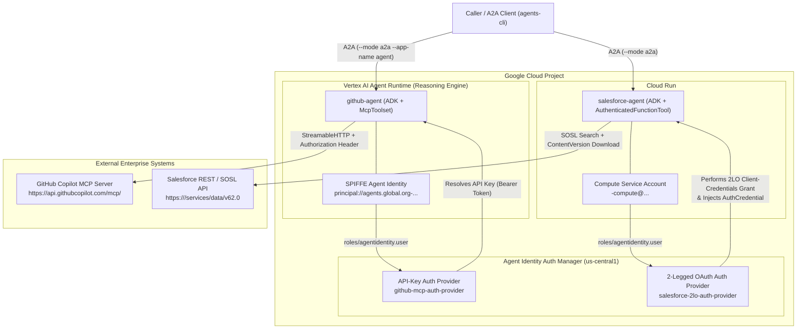

# Agent Identity Foundations (APEX009) — Consolidated Lab Runbook

This repository contains the complete, end-to-end **Runbook** and refactored agent source code from the **Agent Identity Foundations (Lab 2 / APEX009)** lab on Google Cloud.

## Overview

In this lab, two enterprise AI agents built with the **Google Agent Development Kit (ADK)** and exposed over **Agent-to-Agent (A2A)** protocol are refactored to eliminate plaintext credentials from `.env` files and instead use **Google Cloud Agent Identity** and **Auth Manager (`authProviders`)**:

1. **`github-agent` (Vertex AI Agent Runtime / Reasoning Engine)**
   - **Workload Identity**: Provisioned with a native Google-managed SPIFFE **Agent Identity** (`principal://agents.global.org-<ORG_ID>.system.id.goog/resources/aiplatform/projects/<PROJECT_NUMBER>/locations/<REGION>/reasoningEngines/<ENGINE_ID>`).
   - **Credential Management**: Migrated from a plaintext `GITHUB_PERSONAL_ACCESS_TOKEN` in `.env` to an **Agent Identity API-Key Auth Provider** (`github-mcp-auth-provider`) bound to `McpToolset` via `GcpAuthProvider` and `GcpAuthProviderScheme`.
2. **`salesforce-agent` (Cloud Run)**
   - **Workload Identity**: Uses the Cloud Run service's Google Cloud Service Account (`<PROJECT_NUMBER>-compute@developer.gserviceaccount.com`).
   - **Credential Management**: Migrated from plaintext `SALESFORCE_CLIENT_ID` and `SALESFORCE_CLIENT_SECRET` in `.env` (with manual 2LO token caching) to an **Agent Identity 2-Legged OAuth (2LO) Auth Provider** (`salesforce-2lo-auth-provider`) bound to `AuthenticatedFunctionTool` via `GcpAuthProvider`, `GcpAuthProviderScheme`, and `AuthConfig`.

---

## Architecture Diagram



---

## Repository Structure

```text
.
├── README.md                                  # Consolidated Lab Runbook (this file)
├── RUNBOOK.md                                 # Standalone copy of the Runbook
├── apex_labs/
│   └── lab2_prereqs.sh                        # Prerequisite bootstrap script reproducing End-of-Lab-1 state
└── agents/
    ├── github-agent/                          # Refactored GitHub MCP Agent (Vertex AI Agent Runtime)
    │   ├── .env.example                       # Sanitized environment variables template
    │   ├── Dockerfile                         # Container image definition
    │   ├── deploy_with_identity.sh            # Two-step REST deployment script enabling AGENT_IDENTITY
    │   └── agent/
    │       ├── agent.py                       # ADK Agent with GcpAuthProvider + McpToolset
    │       ├── main.py                        # FastAPI + A2A application entrypoint
    │       └── requirements.txt               # Python dependencies (google-adk[gcp,agent-identity,a2a,mcp])
    └── salesforce-agent/                      # Refactored Salesforce Files Agent (Cloud Run)
        ├── .env.example                       # Sanitized environment variables template
        ├── agents-cli-manifest.yaml           # agents-cli deployment manifest (acli_version 1.0.0)
        ├── Dockerfile                         # Container image definition
        ├── pyproject.toml                     # Project dependencies including google-adk[gcp,agent-identity]
        ├── uv.lock                            # Locked dependency graph
        └── app/
            ├── agent.py                       # ADK Agent definition + Memory Bank callback
            ├── tools.py                       # AuthenticatedFunctionTool + GcpAuthProviderScheme
            ├── salesforce_client.py           # Credential-free SOSL / ContentVersion REST client
            └── fast_api_app.py                # FastAPI + A2A server
```

---

## Step-by-Step Consolidated Runbook

### Step 1: Authenticate & Configure Environment Variables

Authenticate with Google Cloud CLI and Application Default Credentials (ADC), and export the project, region, project number, and organization ID variables:

```bash
gcloud auth login
gcloud auth application-default login

export PROJECT_ID="<YOUR_PROJECT_ID>"
export LOCATION="us-central1"
export REGION="us-central1"

gcloud config set project "${PROJECT_ID}"

export PROJECT_NUMBER=$(gcloud projects describe "${PROJECT_ID}" --format='value(projectNumber)')
export ORGANIZATION_ID=$(gcloud projects get-ancestors "${PROJECT_ID}" --format=json | jq -r '.[] | select(.type=="organization") | .id')

echo "Project: ${PROJECT_ID} (${PROJECT_NUMBER}), Org: ${ORGANIZATION_ID}, Location: ${LOCATION}, Agents: ${REGION}"
```

---

### Step 2: Run Lab 2 Prerequisites (`lab2_prereqs.sh`)

Fetch the prerequisite setup script from the lab GCS bucket and execute it to install `agents-cli` (`1.0.0`), stage the starter agents in `~/agents`, enable base APIs, and perform the baseline Cloud Run deployment:

```bash
gcloud storage cp -r gs://${PROJECT_ID}-bucket/apex_labs .
bash apex_labs/lab2_prereqs.sh

export PATH="$HOME/.local/bin:$PATH"
agents-cli info
```

Enable the Agent Identity, IAM Credentials, and STS APIs required for Auth Manager and federated SPIFFE identities:

```bash
gcloud services enable \
  iam.googleapis.com \
  agentidentity.googleapis.com \
  aiplatform.googleapis.com \
  agentidentitycredentials.googleapis.com \
  iamcredentials.googleapis.com \
  sts.googleapis.com
```

---

### Step 3: Create the GitHub API-Key Auth Provider

Capture your GitHub Personal Access Token (`GITHUB_PAT`) without echoing it to shell history and register an **API-Key Auth Provider** (`github-mcp-auth-provider`) in Agent Identity Auth Manager:

```bash
read -rs GITHUB_PAT && echo   # Paste your GitHub PAT (ghp_...), then press Enter

gcloud alpha agent-identity auth-providers create github-mcp-auth-provider \
  --project="${PROJECT_ID}" \
  --location="${LOCATION}" \
  --api-key="${GITHUB_PAT}"

gcloud alpha agent-identity auth-providers list \
  --project="${PROJECT_ID}" \
  --location="${LOCATION}"

export GITHUB_AUTH_PROVIDER_URI="projects/${PROJECT_ID}/locations/${LOCATION}/authProviders/github-mcp-auth-provider"
echo "${GITHUB_AUTH_PROVIDER_URI}"
```

---

### Step 4: Refactor `github-agent` to Use Auth Manager

#### 4.1 Update `~/agents/github-agent/.env`
Remove `GITHUB_PERSONAL_ACCESS_TOKEN` from `.env` and replace it with `GITHUB_AUTH_PROVIDER_URI`:

```bash
cd ~/agents/github-agent
cat << EOF > .env
GOOGLE_CLOUD_PROJECT=$PROJECT_ID
GOOGLE_CLOUD_LOCATION=global
GOOGLE_GENAI_USE_VERTEXAI=True
MODEL=gemini-3.5-flash
GITHUB_MCP_URL=https://api.githubcopilot.com/mcp/
GITHUB_AUTH_PROVIDER_URI=projects/$PROJECT_ID/locations/$LOCATION/authProviders/github-mcp-auth-provider
EOF
```

#### 4.2 Refactor `~/agents/github-agent/agent/agent.py`
Replace the static `Authorization: Bearer ${GITHUB_TOKEN}` header in [`agents/github-agent/agent/agent.py`](agents/github-agent/agent/agent.py) with `GcpAuthProvider`, `GcpAuthProviderScheme`, and a dynamic `header_provider` on `McpToolset`:

```python
from google.adk.auth.credential_manager import CredentialManager
from google.adk.integrations.agent_identity import GcpAuthProvider, GcpAuthProviderScheme
from google.adk.tools.mcp_tool import McpToolset, StreamableHTTPConnectionParams

GITHUB_AUTH_PROVIDER_URI = os.environ["GITHUB_AUTH_PROVIDER_URI"]

# 1. Register Google Cloud Auth Provider with ADK CredentialManager
CredentialManager.register_auth_provider(GcpAuthProvider())

# 2. Define the Auth Scheme pointing to the Auth Provider resource URI
github_auth_scheme = GcpAuthProviderScheme(name=GITHUB_AUTH_PROVIDER_URI)

# 3. Build McpToolset with a dynamic header_provider that injects the resolved token
def github_mcp_toolset() -> McpToolset:
    """MCP toolset for the GitHub server, authenticated via auth manager."""
    toolset = None

    def github_header_provider(readonly_ctx) -> dict[str, str]:
        if not toolset or not toolset.get_auth_config():
            return {}
        auth_config = toolset.get_auth_config()
        cred = None
        if readonly_ctx and hasattr(readonly_ctx, "get_credential"):
            cred = readonly_ctx.get_credential(auth_config.credential_key)
        if not cred:
            cred = auth_config.exchanged_auth_credential
        if not cred or not cred.http:
            return {}
        token = None
        if cred.http.credentials and cred.http.credentials.token:
            token = cred.http.credentials.token
        elif cred.http.additional_headers:
            token = cred.http.additional_headers.get(
                "X-API-Key"
            ) or cred.http.additional_headers.get("X-GOOG-API-KEY")
        if token:
            return {"Authorization": f"Bearer {token}"}
        return {}

    toolset = McpToolset(
        connection_params=StreamableHTTPConnectionParams(url=GITHUB_MCP_URL),
        auth_scheme=github_auth_scheme,
        tool_filter=GITHUB_TOOL_FILTER,
        header_provider=github_header_provider,
    )
    return toolset
```

---

### Step 5: Deploy `github-agent` with Agent Identity & Bind IAM Policy

#### 5.1 Deploy to Vertex AI Agent Runtime with `deploy_with_identity.sh`
> [!NOTE]
> [`deploy_with_identity.sh`](agents/github-agent/deploy_with_identity.sh) splits the Reasoning Engine deployment into two REST calls against `v1beta1`:
> 1. `POST /reasoningEngines` with `{"spec": {"identityType": "AGENT_IDENTITY"}}` (no source code) so Vertex AI cleanly provisions the SPIFFE federated identity.
> 2. `PATCH /reasoningEngines/${ENGINE_ID}` with the inline source archive and `.env` variables (excluding `identityType` from `updateMask`).

```bash
cd ~/agents/github-agent
chmod 777 ./deploy_with_identity.sh
REGION=us-central1 A2A_APP_NAME=agent AUTH_PROVIDER_NAME=github-mcp-auth-provider DISPLAY_NAME=github-agent-v2 ./deploy_with_identity.sh
```

#### 5.2 Export the Agent Identity Principal & Reasoning Engine URL
Record the `Effective identity` and `Reasoning Engine ID` output by the script:

```bash
export GITHUB_ENGINE_ID="<REASONING_ENGINE_ID>"
export GITHUB_AGENT_IDENTITY="principal://agents.global.org-${ORGANIZATION_ID}.system.id.goog/resources/aiplatform/projects/${PROJECT_NUMBER}/locations/${REGION}/reasoningEngines/${GITHUB_ENGINE_ID}"
export GITHUB_AGENT_URL="https://${REGION}-aiplatform.googleapis.com/v1/projects/${PROJECT_NUMBER}/locations/${REGION}/reasoningEngines/${GITHUB_ENGINE_ID}"
echo "${GITHUB_AGENT_URL}"
```

#### 5.3 Grant `roles/agentidentity.user` on `github-mcp-auth-provider`
Grant permission to both the Reasoning Engine's SPIFFE Agent Identity and your user account to retrieve credentials from `github-mcp-auth-provider`:

```bash
gcloud alpha agent-identity auth-providers add-iam-policy-binding github-mcp-auth-provider \
  --project="${PROJECT_ID}" \
  --location="${LOCATION}" \
  --member="${GITHUB_AGENT_IDENTITY}" \
  --role="roles/agentidentity.user"

gcloud alpha agent-identity auth-providers add-iam-policy-binding github-mcp-auth-provider \
  --project="${PROJECT_ID}" \
  --location="${LOCATION}" \
  --member="user:$(gcloud config get-value account)" \
  --role="roles/agentidentity.user"
```

#### 5.4 Verify `github-agent` over A2A

```bash
agents-cli run --url "${GITHUB_AGENT_URL}" --mode a2a --app-name agent "List all my open GitHub issues"
```

---

### Step 6: Create the Salesforce 2-Legged OAuth (2LO) Auth Provider

Configure your Salesforce Developer Edition My Domain, Connected App Consumer Key (`SF_CLIENT_ID`), and Consumer Secret (`SF_CLIENT_SECRET`), then create the 2LO Auth Provider (`salesforce-2lo-auth-provider`):

```bash
export SF_DOMAIN="<YOUR_ORG_DOMAIN>.my.salesforce.com"
export SF_CLIENT_ID="<YOUR_SALESFORCE_CONSUMER_KEY>"
read -rs SF_CLIENT_SECRET && echo   # Paste your Consumer Secret, then press Enter

gcloud alpha agent-identity auth-providers create salesforce-2lo-auth-provider \
  --project="${PROJECT_ID}" \
  --location="${LOCATION}" \
  --two-legged-oauth-client-id="${SF_CLIENT_ID}" \
  --two-legged-oauth-client-secret="${SF_CLIENT_SECRET}" \
  --two-legged-oauth-token-url="https://${SF_DOMAIN}/services/oauth2/token"

gcloud alpha agent-identity auth-providers list \
  --project="${PROJECT_ID}" \
  --location="${LOCATION}"

export SALESFORCE_AUTH_PROVIDER_URI="projects/${PROJECT_ID}/locations/${LOCATION}/authProviders/salesforce-2lo-auth-provider"
echo "${SALESFORCE_AUTH_PROVIDER_URI}"
```

---

### Step 7: Refactor `salesforce-agent` to Use Auth Manager

#### 7.1 Add `agent-identity` Extra to `pyproject.toml` and Lock Dependencies

```bash
cd ~/agents/salesforce-agent
sed -i 's/google-adk\[gcp\]/google-adk[gcp,agent-identity]/' pyproject.toml
uv lock
```

#### 7.2 Update `~/agents/salesforce-agent/.env`
Remove `SALESFORCE_CLIENT_ID` and `SALESFORCE_CLIENT_SECRET` from `.env`, keeping only `SALESFORCE_DOMAIN` and adding `SALESFORCE_AUTH_PROVIDER_URI`:

```bash
cat << EOF > ~/agents/salesforce-agent/.env
GOOGLE_CLOUD_PROJECT=${PROJECT_ID}
GOOGLE_CLOUD_LOCATION=global
GOOGLE_GENAI_USE_VERTEXAI=True
MODEL=gemini-3.5-flash
SALESFORCE_DOMAIN=${SF_DOMAIN}
SALESFORCE_AUTH_PROVIDER_URI=${SALESFORCE_AUTH_PROVIDER_URI}
EOF
```

#### 7.3 Refactor `app/salesforce_client.py`, `app/tools.py`, and `app/agent.py`

1. **[`agents/salesforce-agent/app/salesforce_client.py`](agents/salesforce-agent/app/salesforce_client.py)**:
   - Removed `client_id`, `client_secret`, and `authenticate()` from `SalesforceClient`.
   - Derived `self.instance_url = f"https://{self.domain}"` directly from the org's My Domain.
   - Updated `search_files(self, access_token: str, query: str)` and `download_version_text(self, access_token: str, version_id: str, name: str)` to accept the `access_token` resolved by Auth Manager on each call.

2. **[`agents/salesforce-agent/app/tools.py`](agents/salesforce-agent/app/tools.py)**:
   - Registered `GcpAuthProvider()` with `CredentialManager` and built `salesforce_auth_config = AuthConfig(auth_scheme=GcpAuthProviderScheme(name=SALESFORCE_AUTH_PROVIDER_URI))`.
   - Removed manual token caching (`_authenticate_and_cache`, `_get_token`) and updated `search_salesforce(credential: AuthCredential, query: str)` to receive the injected `AuthCredential` and extract the OAuth token via `_extract_token(credential)`.
   - Wrapped `search_salesforce` in `AuthenticatedFunctionTool(func=search_salesforce, auth_config=salesforce_auth_config)`.

3. **[`agents/salesforce-agent/app/agent.py`](agents/salesforce-agent/app/agent.py)**:
   - Removed `SALESFORCE_CLIENT_ID` and `SALESFORCE_CLIENT_SECRET` environment lookups and initialized `SalesforceClient(domain=SALESFORCE_DOMAIN, api_version=os.environ.get("SALESFORCE_API_VERSION"))`.

---

### Step 8: Deploy `salesforce-agent` to Cloud Run & Bind IAM Policy

#### 8.1 Deploy `salesforce-agent` via `agents-cli`

```bash
cd ~/agents/salesforce-agent
agents-cli deploy --project "${PROJECT_ID}" --region "${REGION}" \
  --no-confirm-project --no-wait \
  --update-env-vars "$(grep -v '^#' .env | grep -v '^$' | grep -v '^GOOGLE_CLOUD_PROJECT' | paste -sd,)"

agents-cli deploy --status
```

#### 8.2 Grant `roles/agentidentity.user` on `salesforce-2lo-auth-provider`
Retrieve the Cloud Run service account and grant `roles/agentidentity.user` on `salesforce-2lo-auth-provider` to both the Cloud Run service account and your user account:

```bash
export SF_SA=$(gcloud run services describe salesforce-agent --region "${REGION}" \
  --format='value(spec.template.spec.serviceAccountName)')
echo "${SF_SA}"

gcloud alpha agent-identity auth-providers add-iam-policy-binding salesforce-2lo-auth-provider \
  --project="${PROJECT_ID}" \
  --location="${LOCATION}" \
  --member="serviceAccount:${SF_SA}" \
  --role="roles/agentidentity.user"

gcloud alpha agent-identity auth-providers add-iam-policy-binding salesforce-2lo-auth-provider \
  --project="${PROJECT_ID}" \
  --location="${LOCATION}" \
  --member="user:$(gcloud config get-value account)" \
  --role="roles/agentidentity.user"
```

#### 8.3 Disable IAP on Cloud Run & Verify `salesforce-agent` over A2A

```bash
gcloud run services update salesforce-agent --region="${REGION}" --no-iap

export SF_URL=$(gcloud run services describe salesforce-agent --region "${REGION}" --format='value(status.url)')
echo "${SF_URL}"

agents-cli run --url "${SF_URL}" --mode a2a "Search for any architecture decision records about timeouts."
```

---

## Summary of Key Differences: Before vs. After Lab 2

| Aspect | Lab 1 State (Before) | Lab 2 State (After) |
| :--- | :--- | :--- |
| **GitHub Secret Storage** | `GITHUB_PERSONAL_ACCESS_TOKEN` in `.env` | Stored in Agent Identity API-Key Auth Provider (`github-mcp-auth-provider`) |
| **GitHub Agent Identity** | Default Reasoning Engine Service Agent | Dedicated SPIFFE Workload Identity (`principal://agents.global.org-...`) |
| **GitHub MCP Authentication** | Hardcoded `Authorization: Bearer` header in `StreamableHTTPConnectionParams` | `GcpAuthProviderScheme` + `header_provider` callback on `McpToolset` |
| **Salesforce Secret Storage** | `SALESFORCE_CLIENT_ID` & `SALESFORCE_CLIENT_SECRET` in `.env` | Stored in Agent Identity 2LO Auth Provider (`salesforce-2lo-auth-provider`) |
| **Salesforce Token Flow** | Manual `requests.post` to `/services/oauth2/token` + session caching | Automatic 2LO exchange by Auth Manager injected via `AuthenticatedFunctionTool` |
| **Access Control** | Any code reading `.env` had full secret access | Enforced by Google Cloud IAM (`roles/agentidentity.user` per Auth Provider) |
